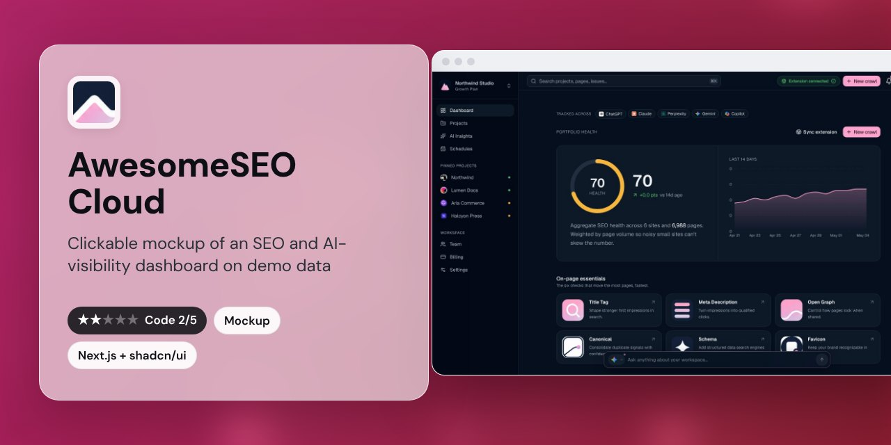
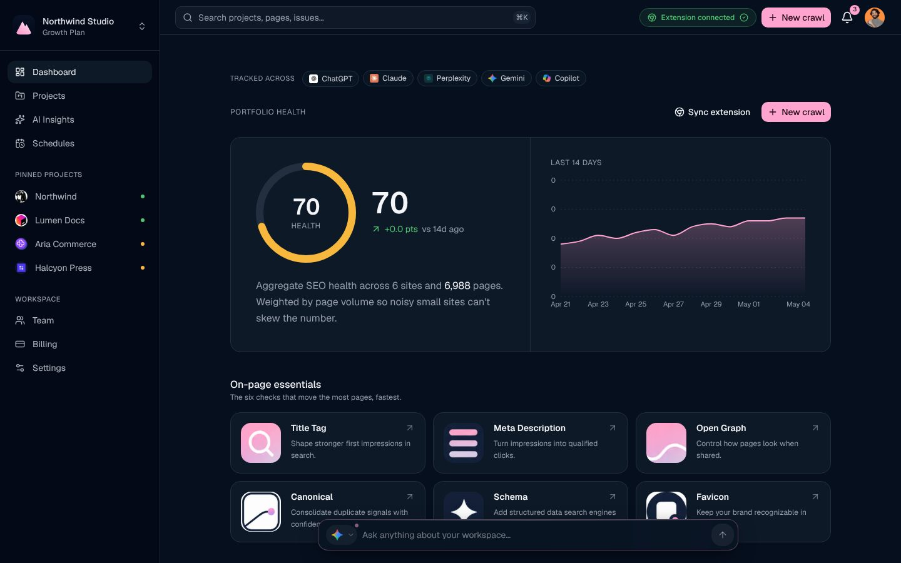
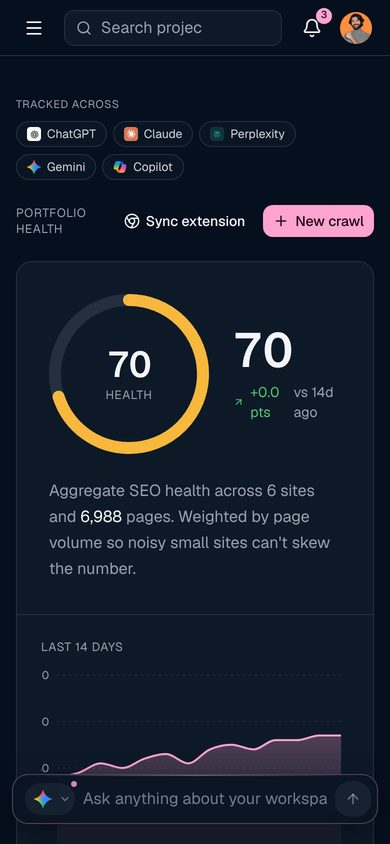

<!-- repo-card:start -->

<h2> AwesomeSEO Cloud</h2>

**A clickable design mockup of an SEO dashboard: site health scores, page and issue lists, an internal link map, topic coverage and how often AI assistants like ChatGPT or Perplexity mention a site. Every number comes from built-in demo data.**

**Vision:** a cloud SEO tool that crawls your sites, suggests fixes with AI, tracks how visible you are in AI search engines and lets a team share workspaces (inferred from the code and its page title).

| | |
|---|---|
| **Status** | Mockup on demo data, never connected to real crawls. Behind a small riddle gate as a private demo |
| **Code quality** | ★★☆☆☆ 2/5. Polished UI made with v0 on fake data, one real AI chat route, no backend, tests or docs |
| **Size** | About 9,200 lines of own code (1,300 of them demo data), no test files |
| **Stack** | Next.js 16, AI SDK 6, shadcn/ui, Recharts, d3-force, Tailwind 4 |
| **What works** | Portfolio dashboard with health score, per-project pages, AI visibility per engine, link graph, topic heatmap, page and issue tables, streaming AI chat bar that answers from a fixed demo snapshot, onboarding screens |
| **Worth reusing** | `components/link-graph.tsx` d3-force internal link graph; `components/topic-heatmap.tsx` topic coverage heatmap; `components/engine-logos.tsx` + `lib/engine-meta.ts` logos and data for AI search engines |
| **Renamed** | Was `awesomeseo` until 25 Nov 2026 |

 

Running locally from this repo's code with its demo data, 25 Nov 2026

<!-- repo-card:end -->
